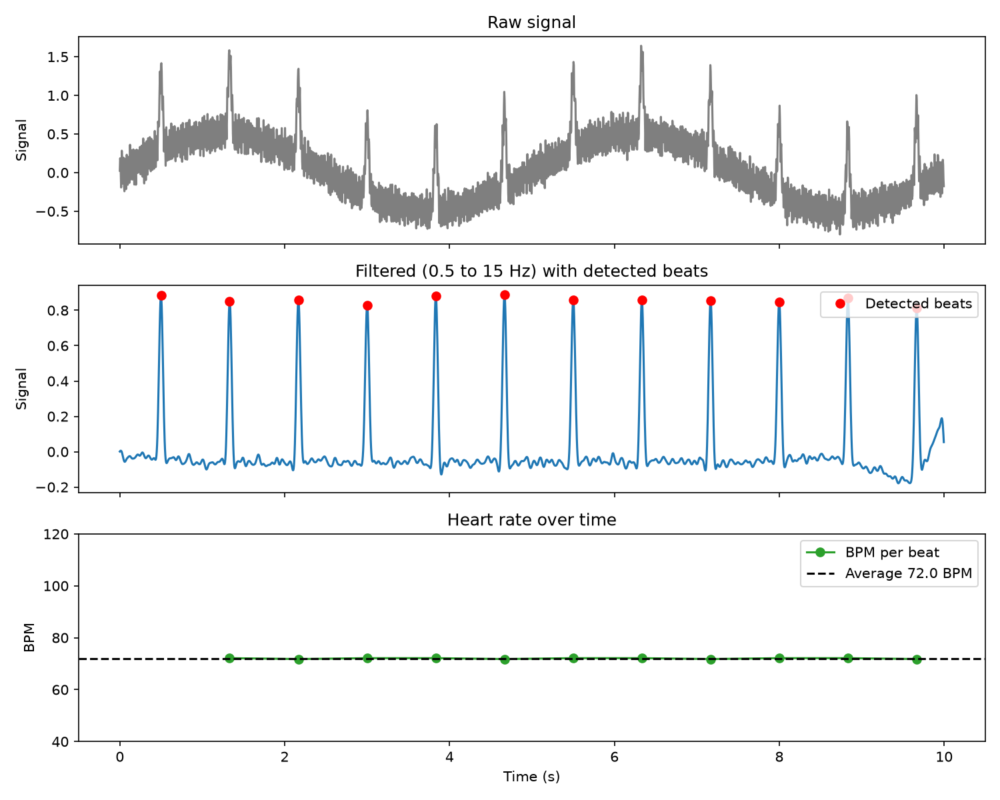

# Heart-Rate Signal Analyser

A command-line tool that cleans a noisy heartbeat signal, finds each beat, and works out the heart rate in beats per minute (BPM).

> **Learning project.** It uses synthetic (fake) data. It is not a medical device and must not be used for health decisions.



## What it does

1. Loads a CSV with `time` and `signal` columns (or generates fake data).
2. Removes slow drift and 50 Hz mains hum with a band-pass filter (0.5 to 15 Hz).
3. Finds the beats with peak detection.
4. Works out the average BPM and the BPM for each beat.
5. Saves a three-panel graph.

## How to run

```bash
git clone git@github.com:playfu1-d0ubt/heart-rate-analyser.git
cd heart-rate-analyser
python3 -m venv venv
source venv/bin/activate
pip install -r requirements.txt

python main.py --generate 72      # make fake data at 72 BPM and analyse it
python main.py                    # analyse the saved CSV
python main.py --help             # all options
python -m pytest -q               # run the tests
```

| Option | Meaning | Default |
| --- | --- | --- |
| `--input` | CSV with `time` and `signal` columns | `sample_data/fake_heartbeat.csv` |
| `--rate` | Sample rate in Hz | 250 |
| `--output` | Where to save the graph | `export/heart_rate_analysis.png` |
| `--generate BPM` | Make fake data first | off |

## Limitations

- Tested on synthetic data only, not real recordings.
- The filter band is fixed at 0.5 to 15 Hz.
- Beats must be at least 0.3 s apart, so rates above 200 BPM are not detected.
- A beat must reach half the height of the tallest one. A single huge spike can hide real beats.
- Assumes a steady sample rate.

## What I learned

- Arrays in `numpy` work on a whole signal at once, with no loops.
- A band-pass filter keeps one range of speeds, and `filtfilt` keeps beats in the right place in time.
- Peak detection needs rules (distance and prominence), or noise counts as beats.
- Code can run cleanly and still give a wrong answer, so tests with known answers matter.
- `pytest` can check that bad input stops with a clear message.

## Licence

MIT. See `LICENSE.md`.